# PorchLight

**Helping Indiana communities keep older adults connected: volunteer companions who share a
language, AI conversation starters, translated messages, and an early-warning dashboard for families.
Built for any Indiana town; the demo data is set in Carmel and nearby Central Indiana towns.**

Prototype for the Nextech CSforGood 2026 competition (grades 9-12). Carmel High School


---

## For judges: start here

**What it is.** PorchLight helps a volunteer program keep older adults from slipping into isolation.
It matches each senior with a volunteer companion who shares a language, gives the volunteer three
conversation starters before every call, translates messages between a senior and a volunteer, and
shows the family a dashboard that flags when calls and visits stop happening. It's built for any
Indiana community, starting with Carmel.

**The fastest way to see it:**

1. Open the live site: https://porchlight.world168158.workers.dev (it shows v2 once the team has
   deployed it; until then it still runs v1). Or run it yourself (below).
2. Go to **Sign in** and use a button under **Try a demo account**. One click signs you in as Hal
   (a senior), Samira (a senior who reads Arabic), Ethan (a volunteer), Jordan (a volunteer who uses
   translation), or Mike (Hal's son). You don't need a password.
3. For the coordinator's pages at `/admin`, sign in with the email and password in
   [Demo accounts](#demo-accounts) below. There's no button for the coordinator, and nothing on the
   public site links to `/admin`.
4. Take the 2-minute tour at `/tour`.

**Run it in 3 commands.** You need [Node.js](https://nodejs.org) 20 or newer. There's nothing else to
install: no `npm install`, database, account, or API key.

```bash
git clone https://github.com/CyberCoder-bit/PorchLight.git
cd PorchLight
npm start
```

Then open **http://localhost:3000**. Signed out, you see the public website. Port 3000 busy? Run `PORT=3001 npm start` (Windows PowerShell:
`$env:PORT=3001; npm start`).

[TEAM: after you deploy v2 to Cloudflare, add "Or try it online:" and your workers.dev URL here,
and in step 1 above. Otherwise delete this line.]

### The 2-minute demo

Open **http://localhost:3000/tour** (or **Take the 2-minute demo tour** on the home page). These
are the tour's 8 steps, word for word. Each step on the page has a button that opens it.

1. **Sign in as the coordinator, then reset the demo data.** What to notice: Sign in with
   admin@porchlight.example and the demo password from the README. Then reset, so every date in the
   story lines up with today. After the reset, a link brings you back here.
2. **Family Dashboard: Hal is flagged.** What to notice: Harold ("Hal") shows "Isolation risk" and
   "Contact dropping", so his family sees the problem before it becomes a crisis.
3. **The Needs attention list.** What to notice: A coordinator sees everyone who needs help in one
   list, each with a plain reason and one suggested next step. For Hal, the step is to ask Ethan
   whether yesterday's visit happened.
4. **Match Gene with a companion.** What to notice: Sam scores highest for Eugene ("Gene"), and
   every volunteer who is left out is listed with the reason why.
5. **Ethan's week.** What to notice: This button signs you in as Ethan, a volunteer. You see his
   calls for the next 7 days, with one click to log a call or mark it missed. Hal's visit yesterday
   was never marked, so it waits under "Did these calls happen?". Log it.
6. **Conversation sparks on Hal's profile.** What to notice: Still signed in as Ethan, press "Get
   conversation sparks" for three things to talk about, built from Hal's interests and labeled with
   where they came from. Ethan sees only what he needs: Hal's first name, interests, languages, and
   free times.
7. **See it as Hal's family.** What to notice: This button signs you in as Mike Whitaker, Hal's son.
   He sees only his dad, never the volunteer's call notes, and other pages tell him they are not for
   his account.
8. **Get help in Indiana, and the Accessibility menu.** What to notice: Local help and Indiana 211
   for this community. Then open Accessibility at the top of any page for bigger text, high
   contrast, or dark mode. Every page adapts.

The tour doesn't cover languages yet. To see them, sign out, then press **Samira, a senior who reads
Arabic** on `/sign-in`. Her page is in Arabic, right to left. Open **Messages** (الرسائل): Jordan's
messages appear in Arabic, with "Show original" (عرض النص الأصلي) under each one. Then sign in as
**Jordan, a volunteer who uses translation** and open the same thread: Samira's reply is in English.
The language menu at the top of every page switches between the 8 interface languages.

### Rubric map

| # | Rubric criterion | Where to see it |
|---|---|---|
| 1 | Brief description (350 characters) | [docs/part1_description.md](docs/part1_description.md) |
| 2 | Narrative: market research | [Narrative](docs/part2_narrative.md), "Market research"; full data, sources, and interview guide in [docs/research.md](docs/research.md) |
| 3 | Narrative: how the project solves the challenge | Narrative, "How PorchLight solves the challenge"; tour steps 2-7; Samira and Jordan's messages; the public site (`/how-it-works`, `/for-seniors`, `/for-volunteers`, `/for-families`) |
| 4 | Narrative: how technology was used | Narrative, "How technology was used"; [Tech stack](#tech-stack-and-why), [Accounts](#accounts-and-who-sees-what), [Languages](#languages), [Statewide](#statewide-towns-and-two-time-zones), and [Results](#results-at-the-time-of-writing) below; [docs/architecture-diagram.md](docs/architecture-diagram.md) |
| 5 | Narrative: why and how AI was used | Narrative, "Why and how AI was used"; the `/about-ai` page; [Conversation Spark](#conversation-spark-mock_mode-and-live_mode) and [Translation](#translation-mock-and-live) below |
| 6 | Narrative: team member roles | Narrative, "Team member roles" |
| 7 | Video (10 minutes or less, including future features) | [docs/part3_video_script.md](docs/part3_video_script.md); [TEAM: video link] |
| 8 | Functional solution | `npm start`, the one-click demo accounts, and the tour above; `npm test` |
| 9 | Source code and project documentation | This repository: `src/`, `test/`, this README, and `docs/` |
| 10 | CS for Good impact | Narrative; the gap PorchLight fills in [docs/research.md](docs/research.md), section 3; the language research in section 6; the `/help`, `/languages`, and `/safety` pages |

### Results at the time of writing

Measured on November 4, 2026, on the `v2` branch:

- **Automated tests:** `npm test` ran 318 tests on the final `v2` code, with the Anthropic SDK
  installed. All 318 passed. Without `npm install`, the LIVE-mode tests are skipped and the rest
  pass. All 7 translations have every one of the 1,451 English interface strings; a test checks that.
- **Accessibility:** in v2, Google Lighthouse accessibility scored 100 on `/`, `/for-families`, and
  `/safety`. It also scored 100 on `/sign-up/senior` (mobile), `/admin` (desktop), and Samira's page
  in Arabic, right to left (mobile). In v1, it scored 100 in the
  light, dark, and high-contrast themes, on desktop and at 375px wide with A++ text.
- **Two runtimes:** in v1, Node (`npm start`) and Cloudflare Workers (`npx wrangler dev`) returned
  identical HTML for the demo pages. A v2 review found that the Worker didn't start (V2-B-01), and
  it was fixed. [TEAM: run `npx wrangler dev` once more before you deploy.]

---

## Demo accounts

Every person in the demo is made up. All demo accounts use one shared demo password:
`PorchLight-demo-2026`. It is written here and nowhere else: the code stores only a PBKDF2 hash of it.
This is a demo, so please don't use a real password or real details when you sign up.

On `/sign-in`, under "Try a demo account", each button signs you in as one person with a single
click. There is no button for the coordinator.

| Button | Signs you in as | What you see |
|---|---|---|
| Hal, a senior | Harold "Hal" Whitaker, 88, Carmel | His own page: his companion's first name, his next visit, his family code |
| Samira, a senior who reads Arabic | Samira Haddad, 76, Fishers | Her own page. Her account asks for Arabic, so PorchLight shows Arabic wherever that translation exists |
| Ethan, a volunteer | Ethan Brooks, Carmel | His week, his senior's first name and interests, his own calls |
| Jordan, a volunteer who uses translation | Jordan Lee, Fishers | His week with Samira, who speaks Arabic |
| Mike, Hal's son | Mike Whitaker | Hal's card on the Family Dashboard and Hal's weekly summary. Call notes stay private |

To sign in with a password, use any email below with the shared demo password.

| Email | Who |
|---|---|
| `admin@porchlight.example` | Casey Reed, the coordinator. Opens everything under `/admin` |
| `hal@porchlight.example` | Hal, senior |
| `samira@porchlight.example` | Samira, senior (Arabic) |
| `ethan@porchlight.example` | Ethan, volunteer |
| `jordan@porchlight.example` | Jordan, volunteer (uses translate help) |
| `mike@porchlight.example` | Mike, Hal's son (family) |
| `noah@porchlight.example` | Noah, a volunteer still waiting for approval |
| `ellen@porchlight.example` | Ellen, Walter's daughter, whose family link is still waiting |

Everyone else follows the pattern `firstname@porchlight.example`: seniors dorothy, rosa, eugene,
thanh, cing, aung, mei, marguerite, helga, walter; volunteers maya, linda, sam, kevin, david, amy,
olivia; family karen, daniel, grace, omar, linh, ryan, sophie, peter.

The coordinator's pages are at `/admin`. Nothing on the public site links there. Sign in as
`admin@porchlight.example` to approve Noah and Ellen at `/admin/approvals`. "Reset demo data"
(`/admin/demo/reset`) brings back the demo story and deletes every new sign-up and session. You
stay signed in.

---

## What PorchLight does

PorchLight pairs older adults with volunteer "Porch Light" companions (high school students,
retirees, neighbors) for regular phone calls, video calls, and visits. It works as a loop:

1. **Match.** A coordinator pairs each senior with a volunteer who shares their interests, free
   time, and a language.
2. **Connect.** Calls and visits are scheduled and logged, with timestamps.
3. **Spark.** Before each call, the volunteer gets three personal conversation starters.
4. **Watch.** A family dashboard counts the calls and visits that actually happened and raises a flag
   when contact starts to drop off, before isolation turns into a crisis.

It's built for Indiana. Seniors and volunteers each have a town, every list can be filtered by town,
and one deployment serves the listed towns in its time zone (66 towns in 52 counties so far; adding
one is a single line). Seniors, volunteers, and family members sign up for their own accounts, and
each one sees only their own pages. A coordinator approves new volunteers and family links. The
screens come in 8 languages, and a matched pair can write to each other in two different languages.
The demo has 12 seniors and 10 volunteers in Carmel, Fishers, Westfield, Noblesville, Zionsville,
Lebanon, Greenwood, Indianapolis, and Anderson. PorchLight is a prototype: no real program uses it,
and it has no partners or pilots yet.

## Screenshots

The v2 public site, at 1280px and 375px wide (taken on November 4, 2026):

| | |
|---|---|
|  | 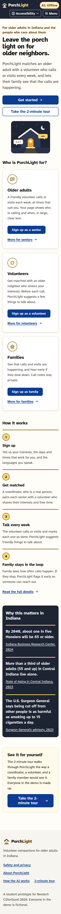 |
| Home, 1280px | Home, 375px |
| 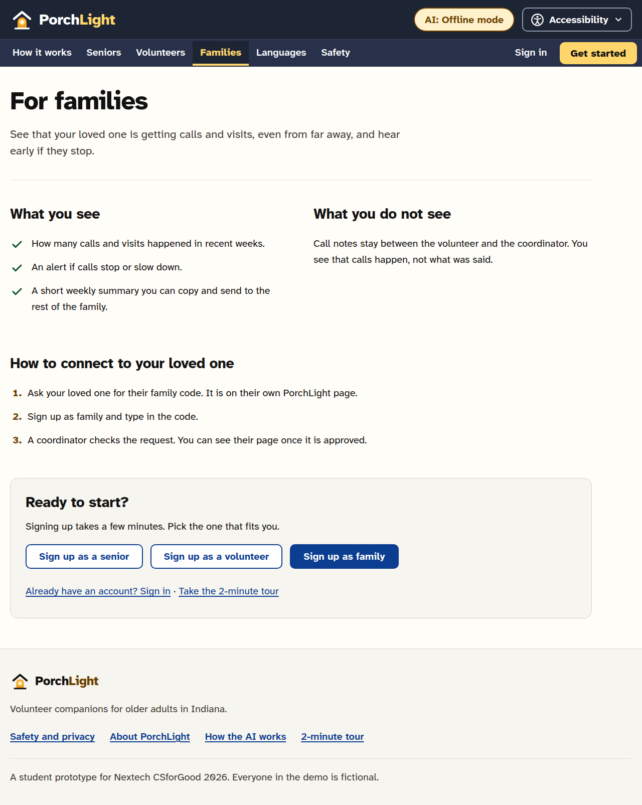 | 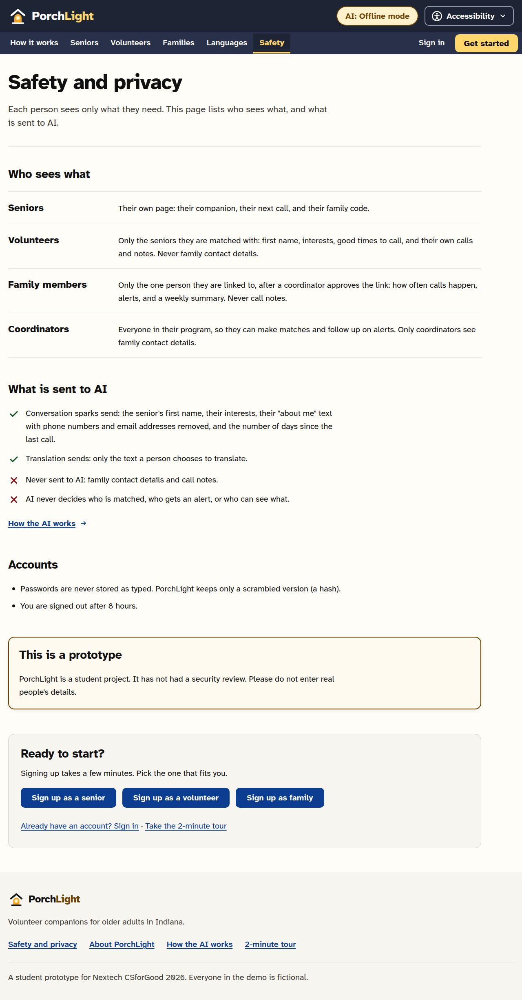 |
| For families | Safety |
|  | 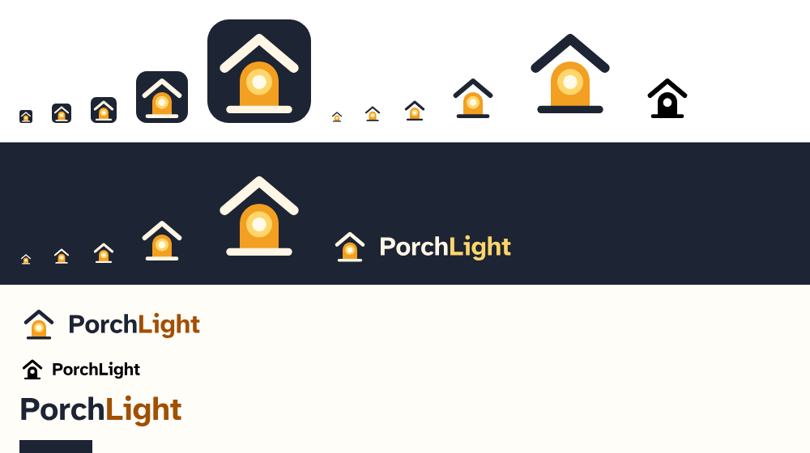 |
| Coordinator home (`/admin`) | Brand sheet |

The screenshots below are from v1 (November 4, 2026, after the round 2 fixes). The app pages look
the same in v2 apart from the new header, logo, and fonts. The v1 sign-in screenshot shows the old
demo sign-in, which v2 replaced with real accounts. [TEAM: retake `sign-in.png` and `family-view.png`
from v2, and add one of Samira's page in Arabic.] On a 375px phone screen the header is compact and
the navigation sits behind the Menu button.

| | |
|---|---|
| 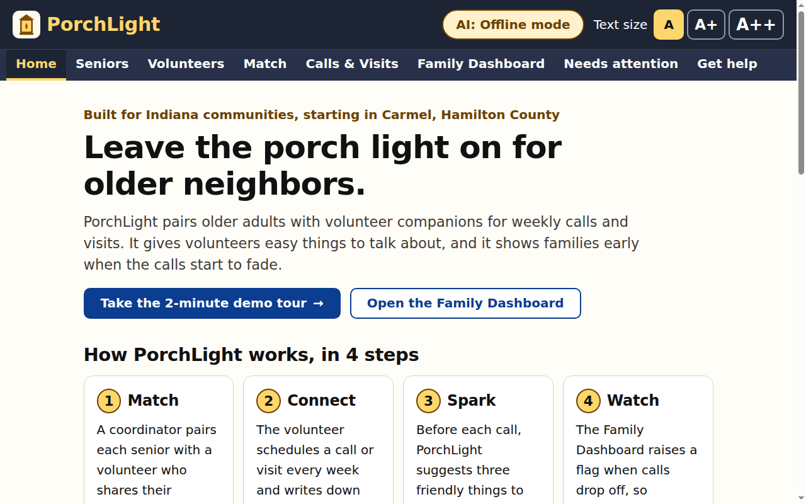 | 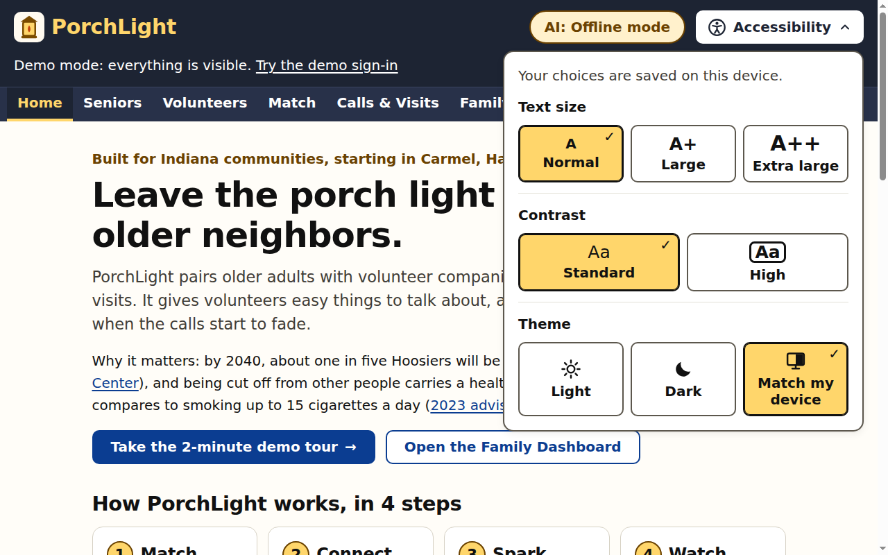 |
| Home | The Accessibility menu |
| 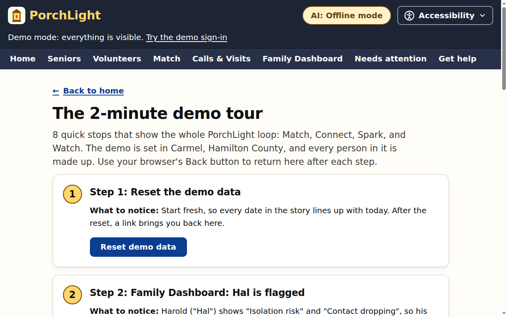 |  |
| The 2-minute demo tour | Needs attention |
| 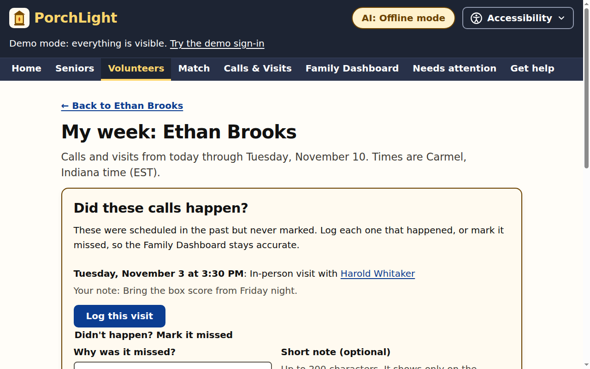 |  |
| My week (Ethan) | Conversation sparks |
| 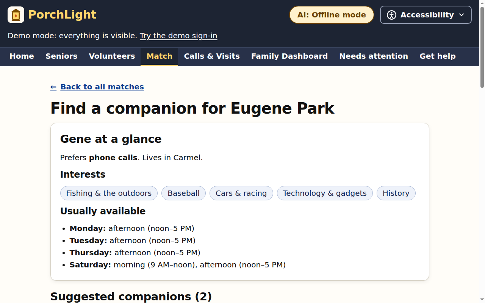 | 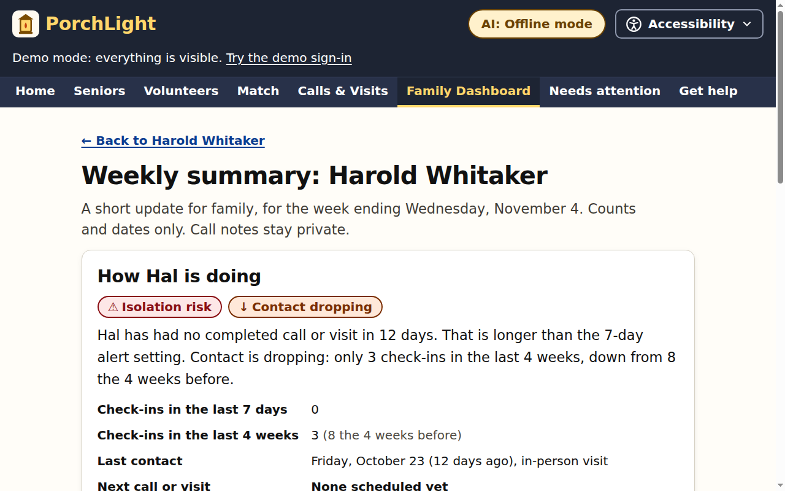 |
| Matching Gene | Weekly family summary |
| 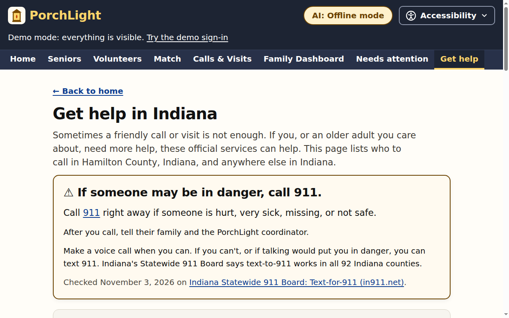 | 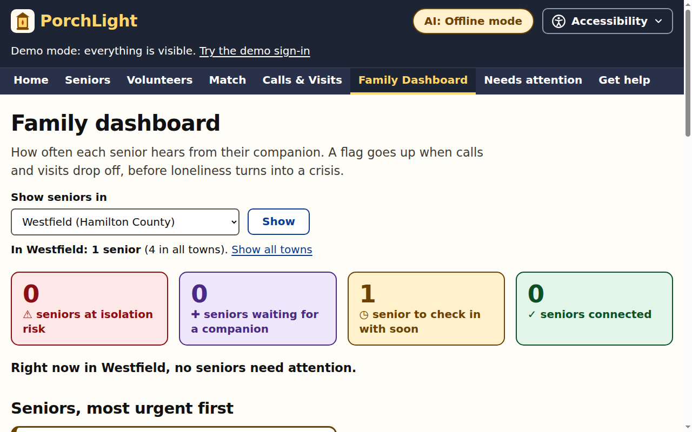 |
| Get help in Indiana | Town filter (Westfield) |
| 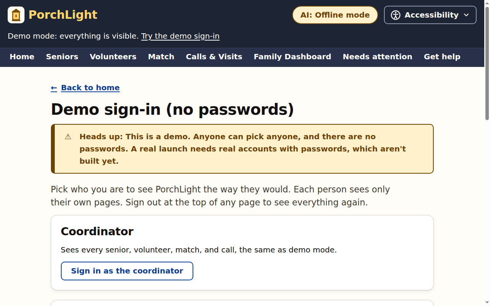 | 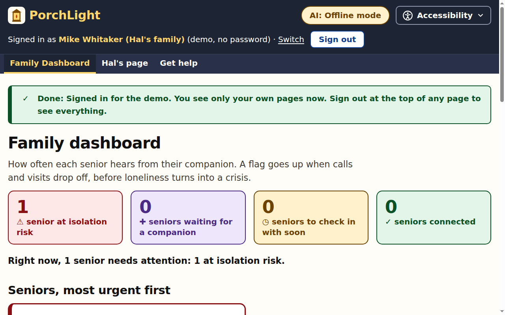 |
| v1 demo sign-in (replaced in v2) | Family view (Mike, Hal's son) |
| 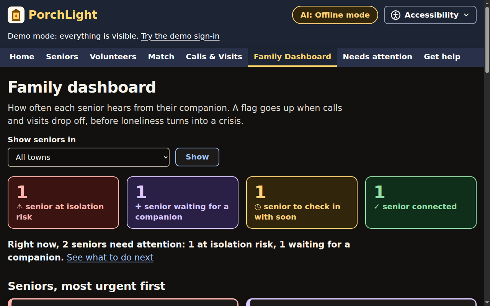 | 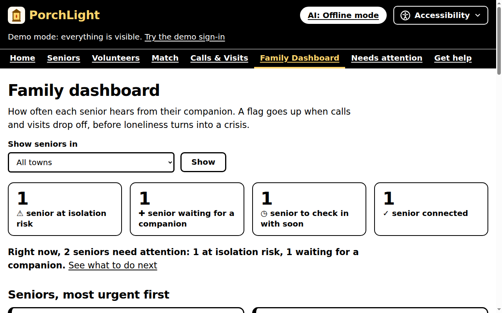 |
| Dark mode | High contrast |
| 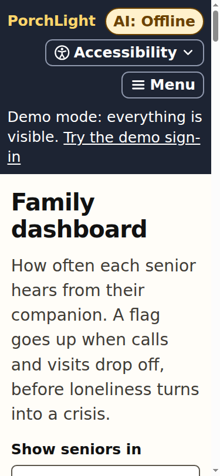 | 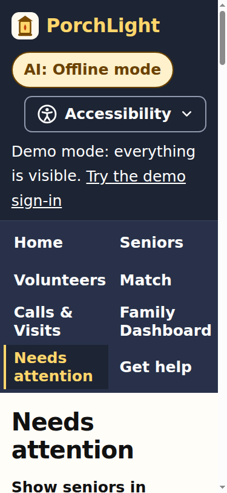 |
| Dashboard, 375px wide, A++ | Needs attention, 375px wide, A++ |
| 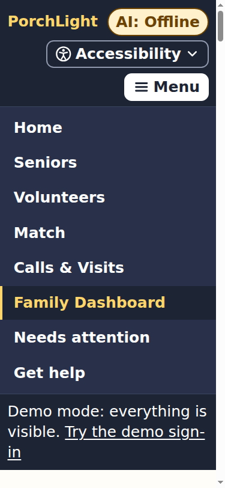 | |
| The phone Menu, 375px wide, A++ | |

## Commands

| Command | What it does |
|---|---|
| `npm start` | Run the app at http://localhost:3000 |
| `npm test` | Run the automated tests |
| `npm run reset` | Reset the demo data, with dates moved so the story starts today |
| `npm install` | **Optional.** Only needed for LIVE AI mode (installs the official Anthropic SDK) or for Cloudflare (installs wrangler) |
| `npm run dev` | Run the Cloudflare Workers version locally at http://localhost:8787 |
| `npm run deploy` | Put PorchLight on the internet with Cloudflare Workers (see below) |

It was tested on Node 24. Check your version with `node --version`. On first run, PorchLight creates
`data/db.json` with 12 fictional seniors, 10 fictional volunteers, 10 family accounts, and the
coordinator, so the demo works right away. To keep the data somewhere else, set `DATA_FILE`, for
example `DATA_FILE=/tmp/pl/db.json npm start`.

## Put it on the internet (Cloudflare Workers)

The exact same app also runs on Cloudflare Workers, on the free plan. Pages are served by a Worker
(`src/worker.js`), and the data lives in a Durable Object, a single always-consistent piece of
storage, instead of `data/db.json`.

```bash
npm install            # one time: installs wrangler (and the Anthropic SDK)
npx wrangler login     # one time: opens a browser so you can sign in to Cloudflare
npm run deploy         # prints your URL, like https://porchlight.<your-subdomain>.workers.dev
```

- **Optional LIVE mode:** `npx wrangler secret put ANTHROPIC_API_KEY`, then deploy again.
- **Run `npm install` and `wrangler` on the same system you'll deploy from.** wrangler includes a
  native program, so a `node_modules` folder installed in WSL won't work from Windows PowerShell,
  and vice versa.
- **Times stay in local time.** Cloudflare's servers run on UTC, so every date and time in
  PorchLight goes through `src/tz.js`, which uses the deployment's time zone. A call scheduled for
  4:00 PM is 4:00 PM in Carmel, wherever the server is.
- **Auto-deploy on every push:** in the Cloudflare dashboard, go to Workers & Pages → Create →
  Import a repository, pick this GitHub repo, and keep the deploy command `npx wrangler deploy`.
- The demo accounts share one password that is printed in this README, and the one-click demo
  buttons need no password at all. That's fine for fictional demo data, but don't put real people's
  information in a public deployment. Before a real launch, remove the demo accounts and buttons.

## A longer walkthrough

Sign in as `admin@porchlight.example` first (see [Demo accounts](#demo-accounts)). Steps 1-9 and 11
use the coordinator's pages.

1. **Family Dashboard** (`/admin/dashboard`). Harold ("Hal") is flagged **Isolation risk** with **Contact dropping**:
   twice-a-week visits faded, a visit was missed because his volunteer had a conflict, and his last
   completed visit was 12 days ago. Eugene ("Gene") just signed up and **needs a companion**. The
   line under the tiles reads "Right now, 2 seniors need attention: 1 at isolation risk, 1 waiting
   for a companion." Home, the dashboard, and Needs attention use one rule, so they always agree.
2. **Needs attention** (`/admin/attention`). The coordinator's list shows each senior who needs help, why,
   any missed calls with their reasons, and one suggested next step chosen by fixed rules. For Hal it
   says: "Ask Ethan about the last visit." Ethan had a visit with Hal yesterday, and nobody has
   marked it yet. Secondary buttons offer **Schedule a call**, **Find a new companion**, and
   **Family summary**.
3. **My week** (`/volunteers/v-ethan/week`). Ethan sees his calls and visits for the next 7 days in
   Carmel time, plus a "Did these calls happen?" list of past calls that nobody marked. Press **Log
   this visit** for yesterday's visit with Hal. (Each call also has **Mark missed** with a reason: no
   answer, senior was unavailable, volunteer had a conflict, or other, plus an optional note. A call
   can be logged only on or after its scheduled day, and marked missed only after its start time.)
4. **Back to the dashboard.** Hal is now **Connected**, because a visit actually happened.
   **Contact dropping** stays until regular visits come back, since one visit doesn't fix a 4-week
   trend.
5. **Conversation sparks** on Hal's profile: three starters for the next visit, labeled
   "Suggestions only" with where they came from. My week shows each senior's latest sparks next to
   upcoming calls.
6. **Match → Find a companion for Gene.** Sam Rivera is the best match at 25 points. The page shows
   exactly why, and why the other volunteers were *not* suggested (Ethan is at capacity, and Linda
   has no overlapping free time). Click **Match Gene with Sam**.
7. **Calls & Visits.** Schedule Gene's first call. The form suggests the pair's next shared free
   time. Upcoming calls have an **Add to calendar** link that downloads a calendar file.
8. **Weekly family summary** (`/seniors/s-harold/summary`). A printable one-page update with counts
   and dates only (never call notes), plus a box of plain text to paste into a message to a brother
   or sister.
9. **Town filter.** Pick a town at the top of the dashboard, Needs attention, Seniors, or Volunteers.
   `/admin/dashboard?town=Westfield` shows only Rosa, who lives in Westfield.
10. **Each person's own view.** Sign out, then use the one-click buttons on `/sign-in`. Mike
    Whitaker, Hal's son, sees only Hal's dashboard card, Hal's page, Hal's weekly summary, and Get
    help, never call notes. Other pages tell him "This page is not for your account." Hal's own page
    greets him, names his companion and his next call, shows his family code, and shows no risk
    labels.
11. **Alert setting.** As the coordinator, change the dashboard setting from 7 to 4 days, and Rosa
    flips to **Isolation risk**. The coordinator sets the threshold to fit the program; the family
    view shows the flags but not the setting.
12. **Get help in Indiana** (`/help`). The 911 safety line, a "Which one should I call?" guide,
    CICOA Aging & In-Home Solutions (Hamilton County's Area Agency on Aging), Indiana 211, and the
    state's list of Area Agencies on Aging for every other county. Each one shows its official source
    and the date it was checked.
13. **Accessibility.** Open **Accessibility** at the top of any page: text size (A, A+, A++),
    contrast (standard or high), and theme (light, dark, or match my device).
14. **Languages.** Press **Samira, a senior who reads Arabic**. Her page is in Arabic, right to left.
    Open Messages: Jordan's English messages appear in Arabic, each marked as a machine translation,
    with "Show original". Open the phrase card (`/phrases`): common phrases in Arabic and English,
    side by side. Then press **Jordan, a volunteer who uses translation** and open the same thread:
    Samira's Arabic reply is in English. On `/translate`, the conversation helper shows each
    person's words in the other's language (in MOCK mode only the ready-made messages and phrases
    are translated; see [Translation](#translation-mock-and-live)).
15. **Sign-up and approvals.** On `/sign-up`, pick senior, volunteer, or family. A new volunteer sees
    "waiting for approval" until a coordinator approves them at `/admin/approvals`. A family member
    types the senior's family code (shown on the senior's own page), and the coordinator approves
    the link. In the demo, Noah (a volunteer) and Ellen (Walter's daughter) are already waiting.

Use **Reset demo data** (`/admin/demo/reset`, or tour step 1) between run-throughs.

**If a companion can't continue:** as the coordinator, on Needs attention, **Find a new companion** opens a confirm page
(`/attention/:seniorId/rematch`) that shows the match's history. Ending the match keeps every past
call, cancels the pair's future calls (they stay in the history as "Cancelled (the match ended)"),
and takes you to the Match page.

## Features

| Feature | Where it lives |
|---|---|
| Public website for signed-out visitors: home, how it works, pages for seniors, volunteers, and families, languages, safety, about | `/`, `/how-it-works`, `/for-seniors`, `/for-volunteers`, `/for-families`, `/languages`, `/safety`, `/about`; code in `src/views/site/` |
| Accounts with email and password (PBKDF2-SHA256, 40,000 iterations), HttpOnly session cookies that last 8 hours, and rate limits on sign-in and sign-up | `/sign-in`, `/sign-up`, `/account`; code in `src/auth/` |
| Public sign-up for 3 roles: senior, volunteer, family. New volunteers wait for approval. Family members link with the senior's family code, and a coordinator approves the link | `/sign-up/senior`, `/sign-up/volunteer`, `/sign-up/family`, `/admin/approvals` |
| One-click demo accounts: Hal, Samira (Arabic), Ethan, Jordan (translate help), Mike. No button for the coordinator | `/sign-in`, `POST /sign-in/demo` in `src/auth/routes.js` |
| Each role sees only its own data, checked on the server before every request. The coordinator's pages are under `/admin` | `src/roles/access.js` (one table), `src/roles/` |
| Interface in 8 languages: English, Spanish, Simplified Chinese, Burmese, Haitian Creole, German, Arabic (right to left), Vietnamese. Machine-translated | Language menu on every page; `POST /prefs/language`; code in `src/i18n/` |
| Spoken languages with levels (native, fluent, conversational, learning) and a translate-help opt-in on every profile | Sign-up, `/account`, profile forms; `src/i18n/spoken.js`, `src/i18n/fields.js` |
| Rule-based matching by shared interests, free time, and language; in-person visits need the same county | `/admin/match`, logic in `src/matching.js` |
| Messages between a matched pair, each shown in the reader's language, with "Show original" | `/messages`, `/messages/:matchId`; code in `src/translate/` |
| Phrase card (common phrases in two languages, side by side) and a conversation helper | `/phrases`, `/translate` |
| Scheduling and logging calls and visits, with timestamps; missed calls can record a reason; duplicate submits are ignored | `/contacts`, routes in `src/app.js` |
| AI Conversation Spark (MOCK_MODE and LIVE_MODE), localized for each community; in LIVE mode each spark also comes in the senior's main language | Senior profile and My week, logic in `src/sparks/` |
| Family dashboard: check-ins over time and an isolation-risk flag with a configurable threshold | `/admin/dashboard` (everyone), `/dashboard` (a family member's own senior); logic in `src/risk.js`, chart in `src/views/chart.js` |
| Coordinator "Needs attention" list: plain-English reasons, missed calls with reasons, one suggested next step | `/admin/attention`, logic in `src/features/attention.js` and `needsAttention()` in `src/risk.js` |
| Re-match confirm page (ends a match, keeps all history, cancels future calls) | `/attention/:seniorId/rematch` |
| Volunteer "My week": next 7 days, sparks inline, one-click "Log this call/visit," "Mark missed" with a reason, and "Did these calls happen?" | `/volunteers/:id/week`, logic in `src/features/week.js` |
| Printable weekly family summary, with plain text to copy into a message | `/seniors/:id/summary`, logic in `src/features/summary.js` |
| "Add to calendar" file for a scheduled call | `/contacts/:id/calendar.ics`, logic in `src/features/calendar.js` |
| "Get help in Indiana": 911, the local Area Agency on Aging, Indiana 211, and the statewide list, with sources and dates | `/help`, code in `src/indiana/help-page.js` |
| Statewide towns: a town on every senior and volunteer, and a `?town=` filter on the dashboard, Needs attention, Seniors, and Volunteers | `src/towns/` |
| Logo and design system (Atkinson Hyperlegible Next, night navy and lantern yellow on cream) | `public/brand/`, `public/styles.css`, [docs/brand.md](docs/brand.md) |
| Accessibility menu: text size, high contrast, and light, dark, or device theme, without JavaScript | Every page's header, code in `src/views/layout.js` and `public/styles.css` |
| 2-minute judge demo tour | `/tour`, code in `src/views/pages/extra.js` |
| One community profile per Indiana town (time zone, local touches, local help), with a Central-time sample | `src/community.js` |
| Correct times in both Indiana time zones, including daylight-saving days | `src/tz.js` |
| Print stylesheet (navigation and buttons hidden, key link URLs shown, the family summary printed in full) | `public/styles.css` |
| Demo-ready seed data: 12 seniors, 10 volunteers, 10 family accounts, a coordinator, about 10 weeks of history, and sample messages | `src/seed.js`, `src/translate/demo.js` |

## Accounts and who sees what

- **Passwords** are hashed with PBKDF2-SHA256 through Web Crypto, 40,000 iterations, with a random
  salt per user (`src/auth/password.js`). The seed stores only hashes.
- **Sessions** use a random 32-byte token in an HttpOnly, SameSite=Lax cookie (`pl_session`), Secure
  on https. Only the token's SHA-256 is stored. A session lasts 8 hours.
- **Rate limits** (`src/auth/limits.js`): at most 5 wrong passwords per email and address in 15
  minutes, and at most 5 new accounts per address in an hour.
- **Sign-up** is open for exactly 3 roles: senior, volunteer, and family. A new volunteer stays
  "pending" and sees only a waiting page until a coordinator approves them. A family member enters
  the senior's family code, and the link waits for a coordinator too. Coordinator accounts can't be
  made through sign-up.
- **Access** is one table, `src/roles/access.js`, checked on the server before every handler runs.
  A volunteer sees only their own week, their own seniors (first name, interests, languages, free
  times, sparks), and their own calls. A family member sees only their own senior's card, page, and
  weekly summary, never call notes. A senior sees their own page. Signed out, you see only the
  public website, the tour, Get help, and How AI is used. Signed out and asking for a private page,
  you're sent to `/sign-in`. Signed in and asking for someone else's page, you get "This page is not
  for your account" (status 403). Hiding a link never counts as protection.
- **The coordinator's pages** are under `/admin`, and every `/admin` page tells search engines not
  to index it. Nothing on the public site links there.

## Languages

The research behind this list is in [docs/research.md](docs/research.md), section 6 (Census table
B16001 for Indiana, plus local sources for Burmese and Chin in Indianapolis).

- **Interface (8 languages):** English (`en`), Spanish (`es`), Simplified Chinese (`zh-Hans`),
  Burmese (`my`), Haitian Creole (`ht`), German (`de`), Arabic (`ar`, right to left), and
  Vietnamese (`vi`). Pick one from the language menu on any page. Signed in, it's saved on your
  account. Otherwise PorchLight uses the `lang` cookie, then your browser's language, then English.
  Dates and times use the reader's language and stay in Indiana time.
- **Every language other than English was machine-translated** and needs a native speaker to
  check it before real use. Each language file (`src/i18n/<code>.js`) says so at the top.
- **Spoken languages** are a longer list (`src/i18n/spoken.js`): the 8 above plus Hakha Chin,
  Pennsylvania Dutch, Chinese, French, Hindi, Telugu, Korean, Tagalog, and others. They're used for
  matching. Hakha Chin and Pennsylvania Dutch are spoken-language options only: there's no interface
  in them, because we can't check a translation.

## Translation: MOCK and LIVE

Messages, the phrase card, and the conversation helper use the same translation service
(`src/translate/service.js`). It follows the sparks' mode.

| | MOCK (default) | LIVE |
|---|---|---|
| What gets translated | The ready-made demo messages (Rosa and Linda, Spanish and English; Samira and Jordan, Arabic and English) and the phrase card | Any message a person writes, by Claude |
| What's sent to the AI | Nothing | Only the text the person chose to translate and the two language names. Names, profiles, family contacts, and call notes are never sent |
| Before sending | The form says AI translation is off and nothing you write leaves PorchLight | The form says the text will be sent to Claude |
| Limits | None needed | 30 translations per account per day and 300 in total (`TRANSLATE_DAILY_PER_ACCOUNT`, `TRANSLATE_DAILY_TOTAL`), counted on the Indiana calendar day. Answers are cached, so the same text is never sent twice |
| If it fails | n/a | Falls back to MOCK and says why |

Every translated message is labeled "Machine translation, may contain mistakes. Don't use it for
medical or money decisions," and has "Show original". AI translates only. It never decides
matching, risk flags, or who may see what.

## Statewide: towns, and two time zones

**Towns.** `src/towns/index.js` lists 66 Indiana cities and towns in 52 of the 92 counties, each
with its county (52 of them are county seats). Seniors and volunteers each have a town. Every list that matters can be filtered by
town (`?town=` on the dashboard, Needs attention, Seniors, and Volunteers), so one coordinator can
look at one town at a time. Phone and video calls work statewide. **In-person visits need the same
county**: that's why Linda, who lives in Indianapolis (Marion County), is left out of Hal's visits
with the reason "Lives in Marion County - too far for in-person visits." The town list is fixed
data: county seats were checked against the Indiana Historical Bureau's county table on in.gov, and
the Hamilton County cities against Visit Hamilton County. A few larger cities haven't been checked
against an official page yet: Zionsville, Greenwood, Plainfield, West Lafayette, Mishawaka,
Elkhart, Gary, Hammond, Portage, Michigan City, and Newburgh.

**Indiana has two time zones.** Most counties use Eastern time. Twelve use Central time: Jasper, Lake,
LaPorte, Newton, Porter, and Starke in the northwest, and Gibson, Perry, Posey, Spencer, Vanderburgh,
and Warrick in the southwest (source: the State of Indiana's
[time zone information page](https://faqs.in.gov/hc/en-us/articles/115005225448-Indiana-Time-Zone-Information),
checked November 3, 2026).

**So PorchLight uses one deployment per time zone.** Every date in a deployment goes through one
clock. The Carmel deployment (Eastern) is for the 80 Eastern-time counties, and a second deployment
with a Central-time profile, such as the `evansville` sample in `src/community.js` (Vanderburgh
County, with SWIRCA & More as its Area Agency on Aging), is for the 12 Central-time counties. **The
time-zone design covers all 92 counties with two deployments. The town list doesn't yet:** it has 66
towns in 52 counties (all 12 Central-time counties, and 40 of the 80 Eastern ones), so the Carmel
deployment's town picker offers 49 towns. Adding a town is one line in `src/towns/index.js` (check
its county on an official page first). A town in the other time zone is rejected by the form, never
saved with the wrong clock, and a `?town=` this deployment doesn't serve shows a notice and every
town.

**Daylight-saving days are handled on purpose.** On March 8, 2026, clocks jump from 1:59 AM to 3:00
AM, so a call typed in for 2:30 AM is rejected with an error about the time. On November 1, 2026,
1:00-1:59 AM happens twice, and PorchLight always uses the first one (still daylight time). The
tests check both zones on both days.

### Launch in another Indiana town

Adding people in another town in the same time zone needs no code: give them that town. To start a
new community profile (for example, the Central-time deployment, or a town with its own local help),
follow these steps, which are also at the top of `src/community.js`:

1. Copy the `evansville` profile and give it a new key and id (lowercase, no spaces), for example
   `kokomo`.
2. Fill in `town`, `county` (for example 'Howard County'), and `state`.
3. Set `timeZone` to `timeZoneForCounty('<Name> County')`. That gives Central time for the 12
   Central-time counties and Eastern time everywhere else.
4. Fill in `help` with the county's Area Agency on Aging. Find it on the
   [FSSA list of Area Agencies on Aging](https://www.in.gov/fssa/ddars/bba/area-agencies-on-aging/),
   then copy its name, website, and phone numbers from that official page or the agency's own site.
   Give every entry a `source` URL and a `checked` date. If you can't verify a phone number, leave it
   out. Indiana 211, the statewide list, and the 911 line are added for every community
   automatically.
5. Optional: add a few `localTouches` for the offline sparks. Leave it empty to use statewide Indiana
   touches instead.
6. Point the app at it: `export const COMMUNITY = COMMUNITIES.<key>;`
7. Replace the fictional demo people in `src/seed.js` (they're set in Carmel), then run `npm test`.

## Tech stack, and why

| Layer | Choice |
|---|---|
| Server | A small router on Web-standard Request/Response (`src/http.js`), run by Node's built-in `http` module locally (`src/node-server.js`) or by Cloudflare Workers (`src/worker.js`) |
| Pages | Server-rendered HTML (`src/views/`) with plain CSS, the Atkinson Hyperlegible Next font (served from `public/`), and a small optional script |
| Data | One JSON document: `data/db.json` locally (written atomically), Durable Object storage on Cloudflare |
| Time | One clock module (`src/tz.js`, with `createClock(timeZone)`) that uses the deployment's time zone, so times are right on any server |
| Accounts | Email and password (PBKDF2 through Web Crypto), server sessions in an HttpOnly cookie, rate limits (`src/auth/`) |
| Access | One table of who may open what (`src/roles/access.js`), checked on the server before every request |
| Languages | `t(key)` text lookup with one file per language (`src/i18n/`); the request's language follows it through AsyncLocalStorage |
| Chart | Inline SVG drawn on the server (no chart library) |
| AI (optional) | Claude through the official `@anthropic-ai/sdk`, for sparks and translation only |
| Tests | Node's built-in test runner (`node --test`) |

We optimized for one thing: **it has to work on a judge's laptop on the first try, even on a
locked-down school network.**

- **No required dependencies.** Core features use only what ships with Node.js, so `npm start` works
  without downloading anything. The Anthropic SDK is the only package, and it's loaded only when LIVE
  mode is turned on.
- **Server-rendered HTML instead of a JavaScript single-page app.** Seniors are our main users.
  Plain HTML pages with real forms and labels work with screen readers, keyboard navigation, browser
  zoom, and old browsers, and they still work if JavaScript fails. Even the Accessibility menu is a
  plain HTML disclosure. Every form uses the Post/Redirect/Get pattern, so pressing Refresh never
  submits a form twice.
- **A JSON file instead of a database.** For a prototype with a few dozen records, it's the most
  reliable option: nothing to install, and judges can open the file and read the data. Writes go to
  a temp file and are then renamed, so a crash can't corrupt it.
- **Add-on modules instead of one big file.** The Needs attention list, My week, the family
  summary, and calendar files live in `src/features/`; Get help in Indiana in `src/indiana/`; towns
  in `src/towns/`; accounts in `src/auth/`; access in `src/roles/`; languages in `src/i18n/`;
  messages and translation in `src/translate/`; the public site in `src/views/site/`; the tour in
  `src/views/pages/extra.js`. Each registers its own routes, so they were built in parallel without
  editing the same files.

What we considered and didn't pick:
- **Express.** It needs `npm install`.
- **SQLite.** The native modules can fail to build, and Node's built-in SQLite isn't in every Node
  version yet.
- **Next.js.** Heavy for a 2-day build.
- **Browser-only localStorage.** The Claude API key would have to live in the browser, where anyone
  could read it.

## Conversation Spark: MOCK_MODE and LIVE_MODE

Many of our volunteers are teenagers. Opening a conversation with someone 60 years older can feel
awkward, and awkward calls are the ones that stop happening. A **Conversation Spark** is three short,
personal starters, built from:

- the senior's **stored interests** and "about me" text;
- the **date of their last contact.** Recent calls get a follow-up opener, about a week gets an easy
  catch-up, and a long gap gets a warm reconnect where the volunteer owns the gap, so the senior
  never feels guilty. A first call gets a first-conversation opener;
- the season, plus local touches from the community profile (for Carmel: the Monon Trail, the
  Palladium, the Carmel Farmers Market, the Christkindlmarkt, and others). A town without local
  touches gets statewide Indiana ones, and a test checks that a non-Carmel town never gets Carmel
  text.

| | MOCK_MODE (default) | LIVE_MODE |
|---|---|---|
| Needs internet or a key? | No | Yes: `ANTHROPIC_API_KEY` |
| How it works | Hand-written template bank (`src/sparks/templates.js`), picked by a seeded random generator | Claude writes the sparks (`src/sparks/live.js`) |
| Repeatable? | Yes. The same inputs always give the same sparks; **Show different sparks** moves to the next variant | No. Each request is fresh |
| If something fails | n/a | Automatically falls back to MOCK sparks, says so on the page, and the header switches to "AI: Offline mode" |

**Bilingual sparks.** In LIVE mode, when a senior's main language isn't English, Claude writes each
starter in English for the volunteer and again in the senior's language, so the volunteer can show
it or read it aloud. In MOCK mode, the built-in starters have translations in the language files,
so the senior's profile can show a starter in the senior's interface language.

Every set of sparks is labeled "Suggestions only," with its source: "From the built-in ideas
(offline mode)" or "Written by Claude, an AI" with the model name. My week shows each senior's latest
saved sparks and never calls the AI when the page loads.

**How MOCK mode stays deterministic and still varies:** the senior's ID, interests, last-contact
date, season, and a variant number are hashed (FNV-1a) into a seed for a small pseudo-random
generator (mulberry32). That generator picks the templates. Different seniors and different gaps
since the last call give different sparks, and the same situation always gives the same ones. That
makes the demo repeatable and the feature testable.

**Why AI is used only for sparks and translation:** matching, risk flags, the Needs attention list,
help resources, towns, accounts, and access are plain rules and fixed data, on purpose. A coordinator can explain every match, a
family can see exactly why a flag went up, and each rule has an exact test.

### Turning on LIVE mode

```bash
npm install                 # installs @anthropic-ai/sdk (one time)
cp .env.example .env        # then paste your key into .env
npm start
```

Or skip the `.env` file and run `ANTHROPIC_API_KEY=sk-ant-... npm start`. The header badge changes
to **AI: Live (Claude)**, and `/about-ai` shows the active mode and why it was chosen. LIVE mode
also turns on LIVE translation.

| Variable | Default | Meaning |
|---|---|---|
| `ANTHROPIC_API_KEY` | (none) | Your Claude API key, from [console.anthropic.com](https://console.anthropic.com) |
| `SPARK_MODE` | `auto` | `auto` = LIVE if a key is set and the SDK is installed, otherwise MOCK. `mock` = always offline. `live` = ask for LIVE and warn if it can't run |
| `CLAUDE_MODEL` | `claude-sonnet-5-5` | Which Claude model writes the sparks |
| `RISK_THRESHOLD_DAYS` | `7` | Starting value for the dashboard alert setting |
| `TRANSLATE_DAILY_PER_ACCOUNT` | `30` | LIVE translations each account may use per Indiana day |
| `TRANSLATE_DAILY_TOTAL` | `300` | LIVE translations the whole deployment may use per Indiana day |
| `DATA_FILE` | `data/db.json` | Where the local data file lives (Node only) |
| `PORT` | `3000` | Web server port |

Details of the live call:
- It uses `messages.create` with **structured outputs** (a JSON schema), so the reply always has the
  right shape.
- It runs at `effort: "low"`, which keeps it quick for short creative text.
- The timeout is 20 seconds, with one retry.
- The prompt names the community's town and tells Claude to mention a local place or event only if
  it's sure the place is real.
- If the API declines, times out, rejects the key, or returns something unexpected, the volunteer
  still gets offline sparks with a short note explaining why.
- Each request is a few hundred tokens, well under one cent at current Sonnet pricing.

**Privacy:** the only things sent to the API are the senior's preferred first name, interest labels,
"about me" text, days since the last contact, the contact type, and today's date and season. Phone
numbers and email addresses typed into "about me" are replaced with "[contact removed]" before
anything is sent. Family and caregiver names and contacts, volunteer call notes, and missed-call
reasons are never sent.

## How matching works (`src/matching.js`)

1. **Must-haves.** A volunteer is only suggested if they:
   - have room (fewer seniors than the maximum they signed up for),
   - share at least one weekly time slot with the senior,
   - offer the senior's preferred contact method (phone, video, or visit),
   - live in the same county, if the senior prefers in-person visits (phone and video work
     statewide),
   - are approved (a pending volunteer is never suggested),
   - share a language with the senior, with both at "conversational" level or better. The one
     exception: if **both** the senior and the volunteer turned on translate help, a pair with no
     shared language is allowed. It gets no language points, and the breakdown says "No shared
     language: both use translate help". That's how Samira (Arabic) and Jordan (English) are matched.
2. **Points.**
   - **+3** for each shared interest. Common ground makes conversations easier, and good
     conversations keep people calling.
   - **+2** for each shared time slot, counting at most 5, so someone who is free all the time can't
     outrank someone with real common interests.
   - **+4** for a shared language, counted once. The breakdown names the language and both levels,
     for example "Shared language: English (Gene native, Sam native)".
   - **+1** if the volunteer has no seniors yet, which spreads the work around.
3. **Ranking.** Highest score first. Ties go to the volunteer with fewer seniors, then alphabetical
   order.

For Gene, Sam Rivera scores 25: 4 shared interests (+12), 4 shared time slots (+8), a shared
language (+4), and the new-volunteer bonus (+1). The match page shows the full points breakdown and
the reason each excluded volunteer was left out.
A coordinator always makes the final choice. If someone later edits a profile so a match no longer
fits, both profiles show a warning.

## How the isolation-risk flag works (`src/risk.js`)

Only **completed** calls and visits count. Scheduled and missed ones don't.

| Flag | Rule (default threshold = 7 days) |
|---|---|
| ⚠ **Isolation risk** | No completed contact for more than the threshold (8+ days) |
| ◷ **Check in soon** | Within 2 days of the threshold (5 to 7 days), or newly matched and still waiting for the first call |
| ✚ **Needs a companion** | Not matched with a volunteer |
| ✓ **Connected** | Regular contact is happening |
| ↓ **Contact dropping** (extra flag) | Check-ins in the last 4 weeks fell to half or less of the 4 weeks before |

The trend flag catches the slow fade. Hal is flagged even though his volunteer is still "assigned,"
because what matters is whether calls are actually happening. A coordinator can change the
threshold (1 to 60 days) on the dashboard at `/admin/dashboard`; a family member never sees the
setting.

A senior **needs attention** if they're at isolation risk, need a companion, have contact dropping,
or had a missed call in the last 14 days. One function, `needsAttention()`, decides this for Home,
the dashboard, and Needs attention, so the number is the same everywhere.

Each senior's card has a chart of completed check-ins per week for 8 weeks, with a "Show weekly
numbers as a table" view of the same numbers for screen readers and anyone who prefers text. Weeks
start and end on local midnights, even across daylight-saving changes.

## Accessibility

Seniors are the primary users, so accessibility was a requirement from the start:

- An **Accessibility** menu at the top of every page, built from plain HTML so it works without
  JavaScript:
  - **Text size:** A, A+, or A++ (20px, 22px, or 25px base text);
  - **Contrast:** standard or high;
  - **Theme:** light, dark, or match my device (the default).
  Choices are saved on the device, and the menu closes when keyboard focus leaves it.
- **A phone-sized header.** On narrow screens the navigation moves behind a **Menu** button (also
  plain HTML, no JavaScript needed) and the AI badge shortens to "AI: Offline", so the page heading
  is near the top of the screen even at A++.
- Text contrast meets **WCAG AAA (7:1)** in the light, dark, and high-contrast themes; a test checks
  the colors (`test/accessibility/contrast.test.js`). Status is always shown with an icon **and**
  words, never color alone. Feedback banners pair an icon, a word, and a color
- Full keyboard support, a "Skip to main content" link, and a thick, high-visibility focus ring
- Every page has one clear heading, and every sub-page has a "Back to ..." link
- Every input has a visible label. Checkbox groups use `fieldset`/`legend`. Form errors appear in a
  summary at the top that receives focus and links to each field
- Click targets are at least 44px. At 375px wide with A++ text, nothing scrolls sideways except data
  tables, which sit in a labeled scroll area, and long names wrap
- Charts have a text summary and a data table
- Respects "reduced motion," the system "increase contrast" setting, and Windows High Contrast mode
- A print stylesheet hides navigation and buttons, prints key link addresses, and prints the family
  summary in full
- Lighthouse accessibility score: **100** (see [Results](#results-at-the-time-of-writing))

## Testing

```bash
npm test                          # the full suite
TZ=UTC npm test                   # same results on a UTC server (like Cloudflare)
TZ=America/Chicago npm test       # same results on a Central-time computer
TZ=America/Los_Angeles npm test   # same results in any other time zone
```

On November 4, 2026, `npm test` ran 318 tests, and all of them passed. Without `npm install`, the
LIVE-mode tests are skipped; after `npm install`, they
run against a local fake Claude server. They cover:
- matching rules and ranking, including language must-haves, the +4 for a shared language, and
  translate help only when both opt in (`test/matching.test.js`);
- risk thresholds, trend detection, and weekly chart buckets (`test/risk.test.js`);
- MOCK sparks (always 3, deterministic, varied, gap-aware) and localized sparks: Carmel touches come
  from the profile, and a non-Carmel profile never produces Carmel text (`test/sparks.test.js`,
  `test/indiana/sparks.test.js`);
- LIVE mode against a local fake Claude server: the request format, privacy (no caregiver details,
  notes, or typed-in phone numbers are sent), and fallback on a bad key, a refusal, bad output, or no
  network (`test/live.test.js`, `test/review/privacy.test.js`);
- accounts: password hashing, sessions and cookies, rate limits, sign-up for each role, approvals,
  and a crawl of every page as each role (`test/roles/accounts.test.js`, `test/roles/roles.test.js`);
- languages: every language file has every English key, the language menu and its order (cookie,
  browser, English), right to left for Arabic, dates in each language, and a pseudo-language run
  over every page that catches English text left outside `t()` (`test/i18n/`);
- messages, the translation service (cache, daily limits, MOCK and LIVE), the phrase card, the
  conversation helper, and bilingual sparks (`test/translate/`);
- both Indiana time zones: 4:00 PM in Carmel is 21:00 UTC in January and 20:00 UTC in July; 2:30 AM
  on March 8 is rejected; 1:30 AM on November 1 picks the first occurrence; midnight boundaries;
  impossible dates (`test/indiana/tz.test.js`, `test/indiana/seed-dst.test.js`);
- the 12 Central-time counties, the help entries' sources and dates, and the `/help` page
  (`test/indiana/help.test.js`);
- towns, the town filter, and the same-county rule for visits (`test/towns/`);
- the Accessibility menu and its colors (`test/accessibility/`);
- the Needs attention list, the re-match flow, My week, the family summary, and calendar files
  (`test/features/`);
- the design rules and the public site (`test/design/`);
- every bug found in review, each as a test that failed before its fix, including the v2
  findings (`test/review/`);
- a full end-to-end run of the app, plus validation, XSS escaping, settings, missed-call reasons, and
  reset (`test/app.test.js`);
- a link crawler that starts from fresh demo data and follows every internal link on every page,
  checking that none is broken (`test/integration/links.test.js`).

## Project structure

```
server.js              Local entry point (npm start)
wrangler.jsonc         Cloudflare Workers settings (npm run deploy)
src/
  app.js               Core routes and form validation; registers the add-on modules below
  community.js         Community profiles: town, county, time zone, local touches, local help
  towns/               Indiana towns and counties, the town filter
  auth/                Accounts: passwords, sessions, rate limits, sign-in, sign-up, approvals
  roles/               Who each person is, and the server-side access table
  i18n/                Interface languages: t(), one file per language, the language menu,
                       spoken languages, and the shared language form fields
  translate/           Messages, the translation service (MOCK and LIVE), phrase card,
                       conversation helper, demo messages
  features/            Needs attention, re-match, My week, family summary, calendar files
  indiana/             Get help in Indiana
  http.js              Tiny web framework on Web-standard Request/Response
  node-server.js       Runs the app on Node's http module and serves /public
  worker.js            Runs the app on Cloudflare Workers + a Durable Object
  store-core.js        Data storage, independent of where the data lives
  store.js             JSON file storage for local runs
  app-config.js        Settings shared by Node and Cloudflare (AI mode, threshold)
  config.js            Local settings (.env file, port, data file)
  tz.js                Clock for the deployment's time zone (createClock for either Indiana zone)
  seed.js              Fictional demo data, dated relative to today
  vocab.js             Shared interest list, time slots, contact methods, missed-call reasons
  matching.js          Matching rules
  risk.js              Isolation-risk rules, weekly counts, and the one "needs attention" rule
  sparks/              Conversation Spark: index (mode switch), mock, templates, live (Claude)
  views/               HTML pages, layout (with the Accessibility and language menus), components,
                       SVG chart; pages/extra.js is the demo tour; site/ is the public website
public/                CSS (themes, high contrast, print styles), fonts, logo files (brand/),
                       small optional script, icons
test/                  Automated tests (features/, indiana/, towns/, roles/, i18n/, translate/,
                       accessibility/, design/, integration/, review/, helpers/, and core tests)
docs/                  Competition write-ups, research, brand, diagrams, screenshots
```

## Documentation

| Document | What's in it |
|---|---|
| [docs/part1_description.md](docs/part1_description.md) | Three options for the 350-character description, with measured counts |
| [docs/part2_narrative.md](docs/part2_narrative.md) | The 2-page narrative, using the rubric's headings |
| [docs/part3_video_script.md](docs/part3_video_script.md) | The video script, with timestamps and a shot list |
| [docs/research.md](docs/research.md) | Market research: data with exact quotes, existing programs, the gap, interview guide |
| [docs/brand.md](docs/brand.md) | The logo, colors, and type |
| [docs/architecture-diagram.md](docs/architecture-diagram.md) | Diagrams of the components, the loop, sparks, the risk flag, and the data model |
| [docs/TEAM-TODO.md](docs/TEAM-TODO.md) | What the team still needs to do before submitting, in order |

## Prototype limitations

- **Not in use yet.** No real volunteer program, senior, or family has used PorchLight. It has no
  partners or pilots.
- **The demo accounts are open on purpose.** Every demo account shares one password, printed in
  this README, and the one-click buttons need none. Real accounts work (hashed passwords, server
  sessions, rate limits), but a real launch would remove the demo accounts and buttons.
- **No email is ever sent.** There's no "forgot password" email, no email check at sign-up, and no
  email alerts. A coordinator would have to reset a password by hand.
- **The translations are machine-made.** The 7 interface languages besides English were
  machine-translated, and no native speaker has checked them yet. Some screens may still show
  English where a translation is missing. Translated messages can be wrong, and each one says so.
- **Hakha Chin and Pennsylvania Dutch are spoken-language options only.** People can list them for
  matching, but there's no interface in them.
- **LIVE translation and LIVE bilingual sparks haven't been tried with a real API key.** They were
  tested against a local fake Claude server.
- **One time zone per deployment, and a partial town list.** Covering all of Indiana takes two
  deployments, one for each time zone. The town list has 66 towns in 52 of the 92 counties so far,
  so people in the other 40 counties can't be entered until their town is added (one line each). A
  few towns in the list haven't been checked against an official page yet.
- **One shared data document.** Locally it's a JSON file; on Cloudflare it's one Durable Object. Both
  are simple and consistent, but a large program would move to real database tables (Cloudflare D1
  or Postgres).
- **No volunteer screening.** A real program needs background checks and training before volunteers
  contact seniors.
- **Notifications are on-screen only.** Families have to open the dashboard or the weekly summary to
  see a flag.
- **Small leftovers:** HEAD requests for static files (like `/styles.css`) return 404. HEAD works
  for pages.
- **"Same county" is a rough stand-in for distance.** A senior and a volunteer a few miles apart can
  be in different counties (Carmel and Indianapolis, for example), so in-person matching is stricter
  than it needs to be.

## Future work

- **Native-speaker review** of each interface language, with help from local community groups
- **Email:** password reset, an email check at sign-up, reminders for volunteers before calls, and
  a message to the family when a flag goes up (plus SMS)
- **A real database** (Cloudflare D1 or Postgres), so a deployment can hold real, not demo, data
- **More interface languages** where we can find people to check them, such as Hakha Chin
- **A phone line** for seniors without internet (an automated "press 1 to request a call" line)
- **Per-senior time zones in one deployment,** so a single PorchLight can serve all 92 counties,
  with the town list completed for every county
- **Partnerships with real volunteer organizations** (school service clubs, senior centers, Area
  Agencies on Aging, faith communities) to recruit, screen, and train companions

## About the data

Every person in the demo data is **fictional**. Names, ages, histories, and families are made up for
the demo.

## Credits

Jason Xu
William Geng
