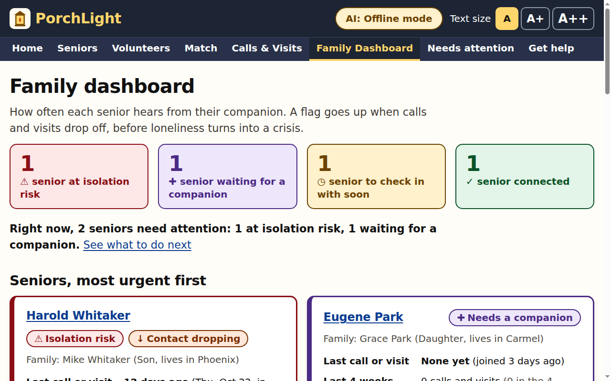
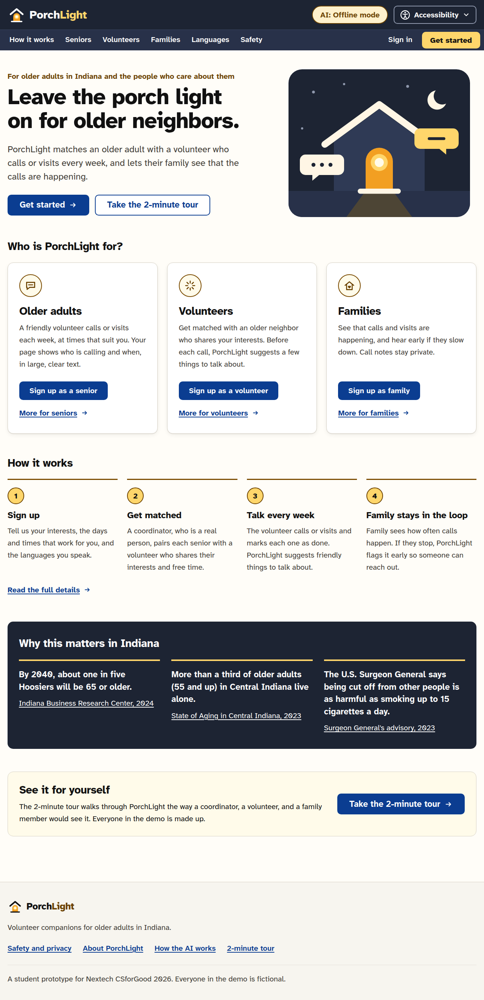
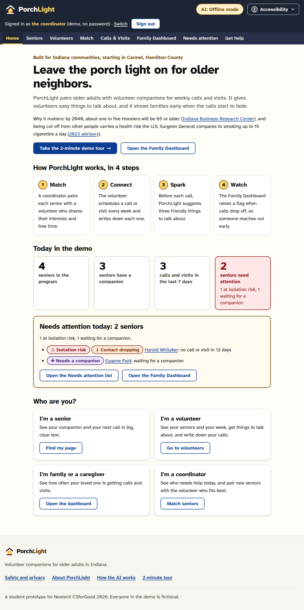
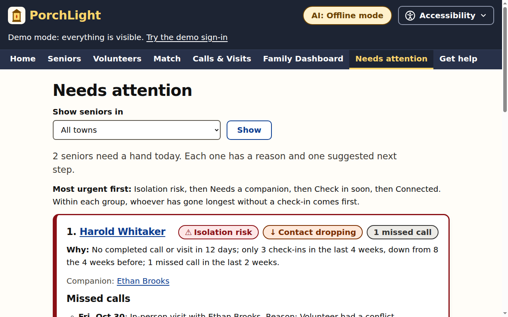
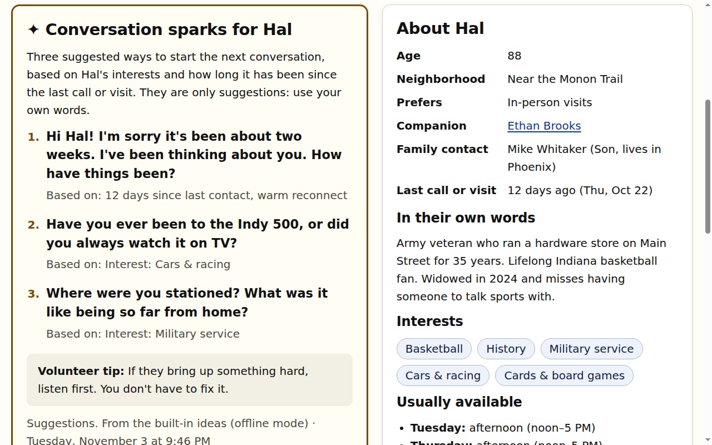

# PorchLight

**Helping Indiana communities keep older adults connected: volunteer companions who share a
language, conversation starters for every call, translated messages, and an early-warning dashboard
for families.**

A student prototype for the Nextech CSforGood 2026 competition, by Jason Xu and William Geng of
Carmel High School.

- **Try it online:** https://porchlight.world168158.workers.dev
- **Video:** link coming soon

## How it works

PorchLight pairs older adults with volunteer companions (high school students, retirees,
neighbors) for regular calls and visits. It works as a loop:

1. **Match.** A coordinator pairs each senior with a volunteer who shares their interests, free
   time, and a language. Each suggestion shows its points and why others were left out.
2. **Spark.** Before each call, the volunteer gets three conversation starters based on the
   senior's interests and how long it's been since the last call.
3. **Connect.** Calls and visits are scheduled and logged. A missed call records a reason.
4. **Watch.** A family dashboard counts the calls that actually happened and flags a senior when
   contact stops or drops by half, before isolation becomes a crisis.

Seniors, volunteers, and family members each sign up for their own account and see only their own
pages. A coordinator approves new volunteers and family links.

## Features

- **Matching** by interests, free time, and a shared language; in-person visits need the same
  county.
- **Conversation sparks:** built-in ideas work offline, and with a free Gemini API key, Gemini
  writes them, in the senior's language too (on Cloudflare, Workers AI is the backup).
- **My week** for volunteers: upcoming calls, one-click logging, and "Did these calls happen?"
- **Needs attention** for coordinators: who needs help, why, and one suggested next step.
- **Family dashboard and weekly summary:** check-ins per week and an isolation-risk flag.
- **8 languages:** English, Spanish, Simplified Chinese, Burmese, Haitian Creole, German, Arabic
  (right to left), and Vietnamese. Messages between a pair appear in each reader's language.
- **Accessibility menu:** larger text, high contrast, and dark mode on every page.
- **Statewide:** towns across Indiana, both time zones, and "Get help in Indiana" (911, Indiana 211,
  and local Area Agencies on Aging).
- **Public website** with pages for seniors, volunteers, and families, plus languages and safety.

## Try the demo

On **Sign in**, the buttons under **Try a demo account** sign you in with one click as Hal (a
senior), Samira (a senior who reads Arabic), Ethan (a volunteer), Jordan (a volunteer who uses
translation), or Mike (Hal's son). The coordinator signs in as `admin@porchlight.example` with the
shared demo password `PorchLight-demo-2026`. The 2-minute tour is at `/tour`. Everyone in the demo is
fictional.

To run it yourself or deploy it, see [docs/setup.md](docs/setup.md).

## Screenshots

| | |
|---|---|
|  |  |
| Home | Coordinator home |
|  |  |
| Needs attention | Conversation sparks |

## Built with

- Node.js with no required dependencies, and server-rendered HTML that works without JavaScript.
  The same code runs on Cloudflare Workers.
- One table of access rules, checked on the server before every request, and passwords hashed with
  PBKDF2.
- 318 automated tests, all passing. We also tested it by hand on desktop computers and phones, and
  Lighthouse accessibility scored 100 on the pages we measured.

## Limitations

- It's a prototype: no real program uses it yet.
- The translations are machine-made and haven't been checked by native speakers.
- No email is sent; alerts are on-screen only.
- A real program would need volunteer background checks and training.

## More

- [How it works in detail](docs/how-it-works.md): accounts, matching, the risk flag, sparks,
  translation, and design choices
- [Setup](docs/setup.md): run, test, deploy, and configure
- [Research](docs/research.md), [architecture diagrams](docs/architecture-diagram.md), and
  [brand](docs/brand.md)

## Credits

Jason Xu and William Geng, Carmel High School
