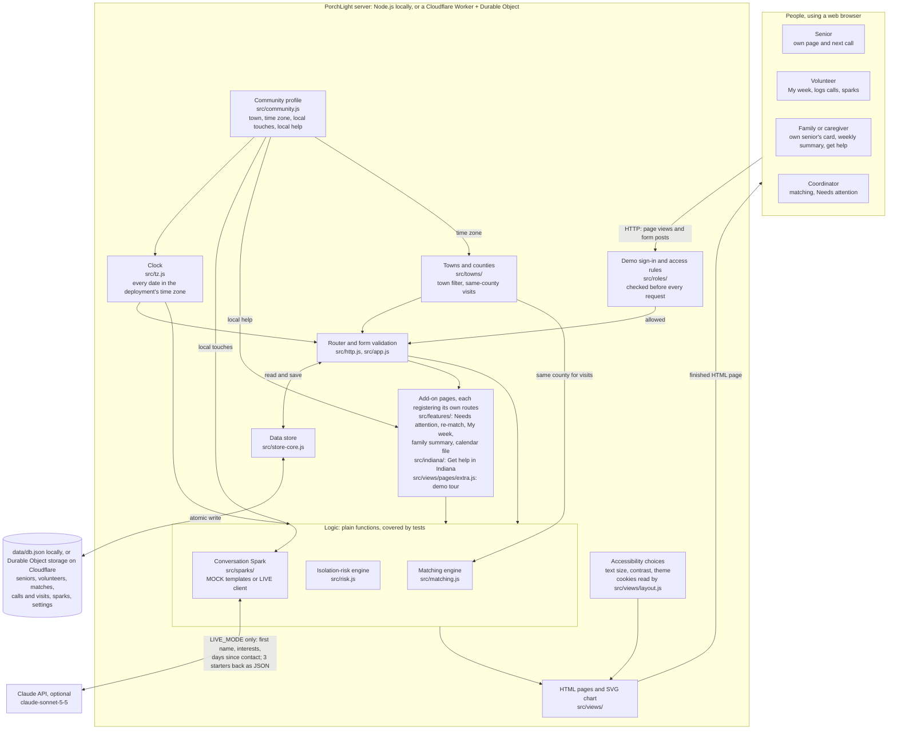
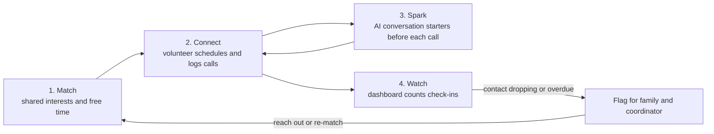
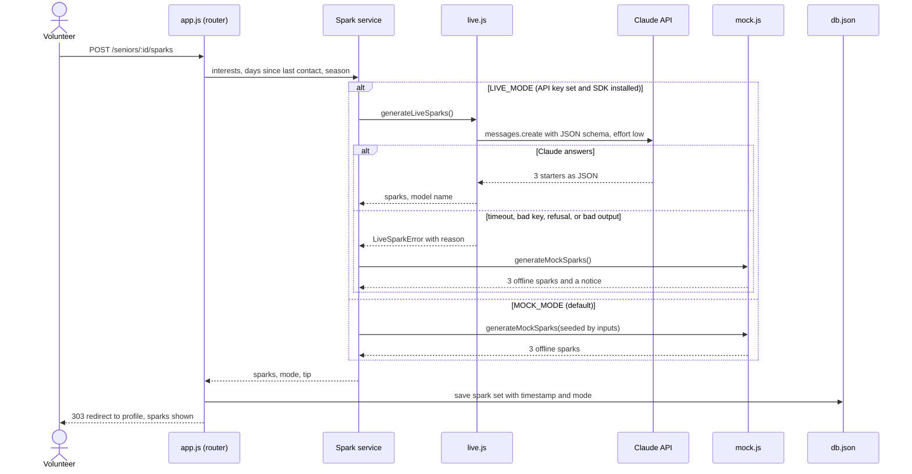
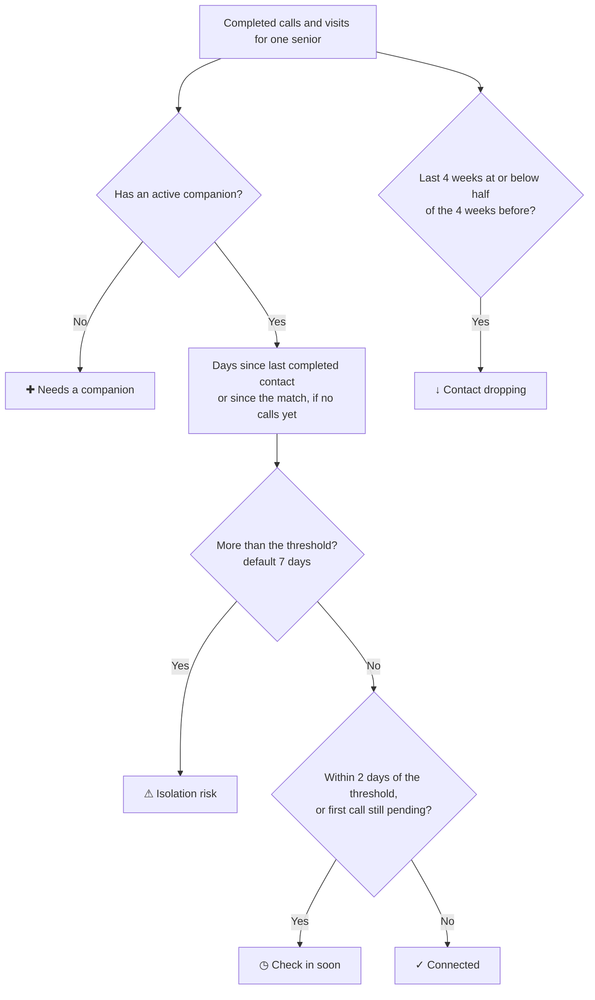
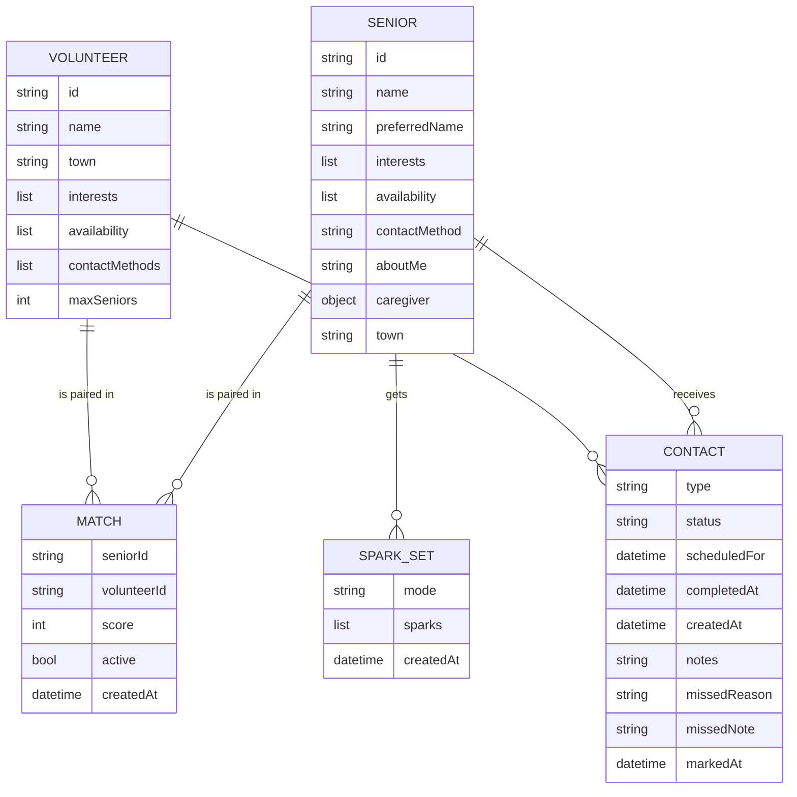

# PorchLight architecture

PorchLight is one small server that renders HTML pages, stores data in one JSON document, and (optionally) calls the Claude API. The same code runs in two places: on a laptop with Node.js (`npm start`, data in `data/db.json`), or on the internet with Cloudflare Workers (`npm run deploy`, data in a Durable Object). These diagrams render automatically on GitHub. You can also paste them into [mermaid.live](https://mermaid.live).

## 1. Components and data flow

**How to read it:** every click in the browser becomes an HTTP request. If someone used the demo
sign-in, the access rules check the request first and answer "This page is for coordinators" for
anything that person shouldn't see; signed out, everything is allowed. Then the request goes to the
router. Everything that changes from one Indiana community to another (its time zone, local touches
for sparks, and local help) comes from the community profile, and every date goes through the clock
module, so times are right even on a server that runs on UTC. One deployment serves every town whose
county shares its time zone, so two deployments cover Indiana's 92 counties. The Accessibility
choices are cookies that the page layout reads, so every page is drawn in the chosen text size,
contrast, and theme without JavaScript. The router asks the right engine for an answer (who matches, who is at risk, what to say on the next call), saves changes through the store, and sends back a finished HTML page. The only data that ever leaves the server is the optional, privacy-limited call to Claude.

## 2. The PorchLight loop

## 3. Conversation Spark: MOCK, LIVE, and fallback

## 4. Isolation-risk flag (per senior)

## 5. Data model

A `CONTACT` has a status of `scheduled`, `completed`, `missed`, or `cancelled` (a future call that was cancelled because its match ended; it stays in the history). Only `completed` contacts count toward the dashboard. A missed contact can record an optional reason (no answer, senior was unavailable, volunteer had a conflict, or other) and a short note. Coordinators see these on the Needs attention list; they are never sent to the AI.
